# Informe de pruebas de carga

Generado por `scripts/load/` (ver `docs/server.md`, sección «Load tests»). Fecha de las mediciones: 2026-11-16.

**Máquina de prueba:** 12 núcleos (AMD Ryzen 5 7500F 6-Core Processor), 15.2 GB de RAM; **el generador de carga, el servidor, PostgreSQL y las demás aplicaciones del equipo comparten esa máquina** (había ~8 GB ocupados por otros procesos). Es un banco de pruebas pesimista para el servidor porque el cliente de carga le quita CPU, y optimista en red (todo va por loopback, sin latencia ni límites de ancho de banda reales).

## Qué se mide y cómo

- Servidor de PokeFocus **local** (`node server/index.ts`, puerto 18787, `NODE_ENV=development` con `DEV_TOOLS=1`) contra **PostgreSQL 16 en docker** (puerto 55432, volumen temporal). Producción usa PostgreSQL 17 con la imagen `pokefocus-app`; el código es el mismo.
- `DEV_TOOLS=1` es necesario porque el servidor decide los minutos de estudio con su reloj y la sesión mínima dura 15 min: los usuarios «que estudian» adelantan su reloj de juego con la cabecera `x-dev-now` (el servidor ejecuta exactamente el mismo reductor, la transacción y los espejos de ranking) en vez de esperar. `DEV_TOOLS` no activa ningún otro camino de coste relevante. En producción está desactivado.
- Límites de uso **activos** (`server/rate-limit.ts`): con `TRUST_PROXY=1` el servidor toma la IP del último salto de `X-Forwarded-For` y cada usuario virtual envía su propia IP (10.x.y.z), exactamente como lo haría un proxy inverso con miles de clientes distintos. Cada usuario tiene su propio email, así que tampoco se acumulan los límites por email.
- Cada usuario virtual mantiene abierta su conexión SSE (`/api/events`), pide estado de juego/rankings/amigos/contenido/config cada ~20 s (±50 %), el 10 % además estudia en bucle (start → claim → dismissResults; ~15 s entre start y claim) y una pequeña fracción inicia sesión de nuevo (`POST /auth/login`, scrypt). Mezcla de consultas: estado 30 %, ranking global 20 %, país 10 %, amigos 10 %, lista de amigos 10 %, contenido 15 % (la mitad con `If-None-Match`), config 5 %; semanal 70 % / mensual 30 %.
- Antes de cada nivel hay una **fase de altas** (registro por la API real + `createPlayer` + una sesión cerrada en el ~30 % para que los rankings tengan filas). Los usuarios se reutilizan entre niveles de la misma ejecución, de modo que la base crece de nivel en nivel.
- Latencias (p50/p95/p99) = de toda la fase de carga (rampa + meseta) y de todas las peticiones salvo las conexiones SSE. Peticiones/s, CPU, RAM, conexiones y ancho de banda = media en la **meseta** (con todos los usuarios activos) y máximo.
- Errores = respuestas 5xx, 4xx inesperadas, tiempos agotados (30 s) y 429 (límite de uso). Los 409 de acciones se cuentan aparte como «conflictos».

## Resumen por nivel de carga

| Usuarios | Rampa+meseta | p95 > 0,5 s desde | req/s (meseta) | p50 ms | p95 ms | p99 ms | Errores | SSE pico | Node CPU (media / pico) | Node RAM máx | PG CPU (media / pico) | PG RAM máx | Conex. PG (máx) | HTTP MB/s (media) | Cuello de botella |
|---:|---|---:|---:|---:|---:|---:|---:|---:|---:|---:|---:|---:|---:|---:|---|
| 100 | 20+60 s | nunca | 6 | 2.2 | 6.1 | 19.9 | 0.00 % | 100 | 1 % / 3 % | 261 MB | 1 % / 2 % | 61 MB | 10 | 0.03 | ninguno: hay holgura (Node 1 %, PG 1 %) |
| 1000 | 60+120 s | nunca | 53 | 1.6 | 14.0 | 31.9 | 0.00 % | 1000 | 7 % / 18 % | 356 MB | 14 % / 21 % | 52 MB | 4 | 0.37 | ninguno: hay holgura (Node 7 %, PG 14 %) |
| 5000 | 120+180 s | nunca | 263 | 1.5 | 53.1 | 62.2 | 0.00 % | 5000 | 26 % / 77 % | 1089 MB | 258 % / 319 % | 102 MB | 10 | 2.14 | CPU de PostgreSQL (media 258 %, p90 296 % de un núcleo; 2.8 de 10 conexiones del pool activas de media) |
| 5000 (fix) | 120+180 s | nunca | 263 | 1.5 | 53.1 | 62.2 | 0.00 % | 5000 | 27 % / 80 % | 1042 MB | 256 % / 322 % | 104 MB | 10 | 2.11 | CPU de PostgreSQL (media 256 %, p90 289 % de un núcleo; 2.6 de 10 conexiones del pool activas de media) |
| 5000 (fix2) | 120+180 s | nunca | 263 | 1.5 | 5.1 | 23.3 | 0.00 % | 5000 | 24 % / 53 % | 1008 MB | 16 % / 24 % | 107 MB | 10 | 2.13 | ninguno: hay holgura (Node 24 %, PG 16 %) |
| 5000 (stats) | 120+180 s | nunca | 264 | 1.4 | 4.9 | 57.5 | 0.00 % | 5000 | 23 % / 51 % | 1013 MB | 19 % / 33 % | 107 MB | 10 | 2.13 | ninguno: hay holgura (Node 23 %, PG 19 %) |
| 10.000 | 180+240 s | 7266 usuarios | 209 | 2205.5 | 30530.6 | 30530.6 | 33.59 % | 10000 | 18 % / 131 % | 2154 MB | 161 % / 925 % | 131 MB | 10 | 0.52 | CPU de PostgreSQL (media 161 %, p90 881 % de un núcleo; 1.6 de 10 conexiones del pool activas de media); errores 33.6 % (tiempos agotados) |
| 10.000 (fix) | 180+240 s | 8153 usuarios | 370 | 4296.0 | 16952.6 | 18335.9 | 0.00 % | 10000 | 49 % / 98 % | 2344 MB | 886 % / 921 % | 141 MB | 10 | 3.03 | CPU de PostgreSQL (media 886 %, p90 907 % de un núcleo; 9.4 de 10 conexiones del pool activas de media) |
| 10.000 (rep) | 180+240 s | 7793 usuarios | 207 | 1676.0 | 30530.6 | 30530.6 | 34.56 % | 10000 | 17 % / 128 % | 2088 MB | 137 % / 914 % | 133 MB | 10 | 0.45 | CPU de PostgreSQL (media 137 %, p90 880 % de un núcleo; 1.5 de 10 conexiones del pool activas de media); pool de conexiones bloqueado (10 transacciones «idle in transaction» a la vez); errores 34.6 % (tiempos agotados) |

CPU: 100 % = un núcleo completo (el servidor Node usa un hilo de JavaScript más el pool de 4 hilos de libuv, que hace el scrypt de registro/login, así que puede superar el 100 %).

## Más detalle por nivel

| Usuarios | Sonda /api/health p50/p95/p99 ms | Descriptores del servidor (máx) | Hilos | TCP establecidas (máx) | Red PG ↔ servidor (media KB/s) | CPU generador (media) | CPU equipo (media) | RAM libre del equipo (mín) | Base (MB) | Usuarios en la base | Eventos SSE recibidos | Reconexiones SSE | Errores en el log del servidor | «idle in transaction» (máx) |
|---:|---|---:|---:|---:|---:|---:|---:|---:|---:|---:|---:|---:|---:|---:|
| 100 | 0.6 / 6.1 / 6.9 | 139 | 11 | 107 | 51 | 0 % | 2 % | 7078 MB | 10 | 100 | 45 | 0 | 0 | 0 |
| 1000 | 0.4 / 0.7 / 5.3 | 1038 | 11 | 1012 | 598 | 2 % | 4 % | 6957 MB | 16 | 1000 | 776 | 0 | 0 | 0 |
| 5000 | 0.4 / 0.6 / 1.2 | 5060 | 11 | 5028 | 3240 | 7 % | 28 % | 5775 MB | 43 | 5000 | 6497 | 0 | 0 | 0 |
| 5000 (fix) | 0.4 / 0.6 / 0.9 | 5069 | 12 | 5029 | 3185 | 7 % | 29 % | 5974 MB | 43 | 5000 | 6309 | 0 | 0 | 1 |
| 5000 (fix2) | 0.4 / 0.7 / 1.1 | 5065 | 12 | 5025 | 2483 | 7 % | 11 % | 4434 MB | 44 | 5000 | 6527 | 0 | 0 | 1 |
| 5000 (stats) | 0.4 / 0.7 / 1.8 | 5057 | 11 | 5025 | 2471 | 7 % | 8 % | 5435 MB | 43 | 5000 | 6389 | 0 | 0 | 1 |
| 10.000 | 0.4 / 0.9 / 5.7 | 18054 | 11 | 18021 | 839 | -2 % | 19 % | 3922 MB | 70 | 10000 | 5734 | 0 | 0 | 0 |
| 10.000 (fix) | 0.5 / 2.9 / 9.1 | 13373 | 11 | 13341 | 4616 | 13 % | 84 % | 3927 MB | 73 | 10000 | 13580 | 0 | 0 | 2 |
| 10.000 (rep) | 0.4 / 1.3 / 6.4 | 18401 | 11 | 18376 | 725 | 3 % | 17 % | 3960 MB | 66 | 10000 | 5589 | 0 | 0 | 10 |

Diagnóstico del bloqueo (10000-rep): `idle in transaction / Client:ClientRead / select "user_id", "doc", "version", "updated_at" from "player_docs" where "player_docs"."user_id" = $1 for update`; `idle in transaction / Client:ClientRead / select "user_id", "doc", "version", "updated_at" from "player_docs" where "player_docs"."user_id" = $1 for update`; `idle in transaction / Client:ClientRead / select "user_id", "doc", "version", "updated_at" from "player_docs" where "player_docs"."user_id" = $1 for update`

### Latencia por operación — 100 usuarios

| Operación | Peticiones | Errores | 429 | Conflictos 409 | p50 ms | p95 ms | p99 ms |
|---|---:|---:|---:|---:|---:|---:|---:|
| `auth.login` | 3 | 0 | 0 | 0 | 57.5 | 59.8 | 59.8 |
| `config.get` | 17 | 0 | 0 | 0 | 0.6 | 0.7 | 0.7 |
| `content.cond` | 20 | 0 | 0 | 0 | 0.6 | 0.9 | 1.5 |
| `content.get` | 114 | 0 | 0 | 0 | 0.4 | 0.6 | 0.7 |
| `friends.get` | 29 | 0 | 0 | 0 | 1.9 | 2.4 | 2.4 |
| `game.claim` | 16 | 0 | 0 | 0 | 6.9 | 20.7 | 20.7 |
| `game.dismiss` | 16 | 0 | 0 | 0 | 3.4 | 8.1 | 8.1 |
| `game.get` | 194 | 0 | 0 | 0 | 2.2 | 2.9 | 5.7 |
| `game.start` | 16 | 0 | 0 | 0 | 4.7 | 6.6 | 6.6 |
| `lb.country` | 23 | 0 | 0 | 0 | 3.7 | 4.2 | 11.5 |
| `lb.friends` | 24 | 0 | 0 | 0 | 3.7 | 4.2 | 5.5 |
| `lb.global` | 62 | 0 | 0 | 0 | 4.7 | 6.6 | 12.0 |
| `sse.connect` | 100 | 0 | 0 | 0 | — | — | — |

### Latencia por operación — 1000 usuarios

| Operación | Peticiones | Errores | 429 | Conflictos 409 | p50 ms | p95 ms | p99 ms |
|---|---:|---:|---:|---:|---:|---:|---:|
| `auth.login` | 58 | 0 | 0 | 0 | 57.5 | 62.2 | 62.2 |
| `config.get` | 328 | 0 | 0 | 0 | 0.3 | 0.5 | 0.6 |
| `content.cond` | 499 | 0 | 0 | 0 | 0.3 | 0.5 | 0.6 |
| `content.get` | 1492 | 0 | 0 | 0 | 0.3 | 0.4 | 0.6 |
| `friends.get` | 673 | 0 | 0 | 0 | 1.2 | 1.8 | 2.1 |
| `game.claim` | 260 | 0 | 0 | 0 | 5.3 | 37.3 | 57.5 |
| `game.dismiss` | 260 | 0 | 0 | 0 | 2.9 | 31.9 | 42.0 |
| `game.get` | 3024 | 0 | 0 | 0 | 1.5 | 2.2 | 4.5 |
| `game.start` | 260 | 0 | 0 | 0 | 3.8 | 4.7 | 7.5 |
| `lb.country` | 645 | 0 | 0 | 0 | 4.2 | 5.1 | 9.8 |
| `lb.friends` | 662 | 0 | 0 | 0 | 2.8 | 3.5 | 5.1 |
| `lb.global` | 1291 | 0 | 0 | 0 | 13.5 | 15.1 | 17.7 |
| `sse.connect` | 1000 | 0 | 0 | 0 | — | — | — |

### Latencia por operación — 5000 usuarios

| Operación | Peticiones | Errores | 429 | Conflictos 409 | p50 ms | p95 ms | p99 ms |
|---|---:|---:|---:|---:|---:|---:|---:|
| `auth.login` | 374 | 0 | 0 | 0 | 53.1 | 59.8 | 64.6 |
| `config.get` | 2630 | 0 | 0 | 0 | 0.2 | 0.4 | 0.7 |
| `content.cond` | 3965 | 0 | 0 | 0 | 0.2 | 0.4 | 0.9 |
| `content.get` | 9044 | 0 | 0 | 0 | 0.2 | 0.4 | 0.6 |
| `friends.get` | 5360 | 0 | 0 | 0 | 1.1 | 1.8 | 4.2 |
| `game.claim` | 2167 | 0 | 0 | 0 | 5.5 | 103.5 | 245.3 |
| `game.dismiss` | 2167 | 0 | 0 | 0 | 3.0 | 141.6 | 201.6 |
| `game.get` | 21375 | 0 | 0 | 0 | 1.3 | 2.1 | 4.3 |
| `game.start` | 2167 | 0 | 0 | 0 | 3.8 | 5.5 | 7.8 |
| `lb.country` | 5423 | 0 | 0 | 0 | 9.5 | 12.4 | 15.1 |
| `lb.friends` | 5442 | 0 | 0 | 0 | 2.7 | 4.0 | 6.6 |
| `lb.global` | 10838 | 0 | 0 | 0 | 51.1 | 62.2 | 69.9 |
| `sse.connect` | 5000 | 0 | 0 | 0 | — | — | — |

### Latencia por operación — 5000 (fix) usuarios

| Operación | Peticiones | Errores | 429 | Conflictos 409 | p50 ms | p95 ms | p99 ms |
|---|---:|---:|---:|---:|---:|---:|---:|
| `auth.login` | 391 | 0 | 0 | 0 | 53.1 | 62.2 | 62.2 |
| `config.get` | 2728 | 0 | 0 | 0 | 0.2 | 0.5 | 0.7 |
| `content.cond` | 4150 | 0 | 0 | 0 | 0.2 | 0.4 | 0.7 |
| `content.get` | 9065 | 0 | 0 | 0 | 0.2 | 0.4 | 0.6 |
| `friends.get` | 5369 | 0 | 0 | 0 | 1.2 | 1.8 | 4.0 |
| `game.claim` | 2104 | 0 | 0 | 0 | 5.7 | 136.2 | 286.9 |
| `game.dismiss` | 2104 | 0 | 0 | 0 | 3.2 | 121.1 | 255.1 |
| `game.get` | 21076 | 0 | 0 | 0 | 1.3 | 2.1 | 4.3 |
| `game.start` | 2104 | 0 | 0 | 0 | 3.8 | 5.5 | 8.4 |
| `lb.country` | 5309 | 0 | 0 | 0 | 9.5 | 12.4 | 15.1 |
| `lb.friends` | 5511 | 0 | 0 | 0 | 2.7 | 4.2 | 6.6 |
| `lb.global` | 10839 | 0 | 0 | 0 | 51.1 | 62.2 | 67.2 |
| `sse.connect` | 5000 | 0 | 0 | 0 | — | — | — |

### Latencia por operación — 5000 (fix2) usuarios

| Operación | Peticiones | Errores | 429 | Conflictos 409 | p50 ms | p95 ms | p99 ms |
|---|---:|---:|---:|---:|---:|---:|---:|
| `auth.login` | 367 | 0 | 0 | 0 | 59.8 | 64.6 | 67.2 |
| `config.get` | 2698 | 0 | 0 | 0 | 0.2 | 0.5 | 0.9 |
| `content.cond` | 4081 | 0 | 0 | 0 | 0.2 | 0.5 | 0.9 |
| `content.get` | 9095 | 0 | 0 | 0 | 0.2 | 0.4 | 0.7 |
| `friends.get` | 5285 | 0 | 0 | 0 | 1.2 | 1.9 | 4.0 |
| `game.claim` | 2177 | 0 | 0 | 0 | 5.5 | 99.5 | 255.1 |
| `game.dismiss` | 2177 | 0 | 0 | 0 | 3.0 | 125.9 | 193.8 |
| `game.get` | 21314 | 0 | 0 | 0 | 1.3 | 2.2 | 4.3 |
| `game.start` | 2177 | 0 | 0 | 0 | 3.8 | 5.5 | 7.8 |
| `lb.country` | 5389 | 0 | 0 | 0 | 1.8 | 7.8 | 9.1 |
| `lb.friends` | 5389 | 0 | 0 | 0 | 2.9 | 4.3 | 6.9 |
| `lb.global` | 10805 | 0 | 0 | 0 | 2.0 | 3.4 | 7.2 |
| `sse.connect` | 5000 | 0 | 0 | 0 | — | — | — |

### Latencia por operación — 5000 (stats) usuarios

| Operación | Peticiones | Errores | 429 | Conflictos 409 | p50 ms | p95 ms | p99 ms |
|---|---:|---:|---:|---:|---:|---:|---:|
| `auth.login` | 361 | 0 | 0 | 0 | 59.8 | 62.2 | 72.7 |
| `config.get` | 2643 | 0 | 0 | 0 | 0.2 | 0.4 | 0.8 |
| `content.cond` | 3981 | 0 | 0 | 0 | 0.2 | 0.4 | 0.7 |
| `content.get` | 9022 | 0 | 0 | 0 | 0.2 | 0.4 | 0.6 |
| `friends.get` | 5523 | 0 | 0 | 0 | 1.1 | 1.8 | 4.0 |
| `game.claim` | 2131 | 0 | 0 | 0 | 5.5 | 165.7 | 363.1 |
| `game.dismiss` | 2131 | 0 | 0 | 0 | 3.0 | 193.8 | 310.3 |
| `game.get` | 21339 | 0 | 0 | 0 | 1.3 | 2.1 | 4.2 |
| `game.start` | 2131 | 0 | 0 | 0 | 3.7 | 5.3 | 8.1 |
| `lb.country` | 5374 | 0 | 0 | 0 | 1.8 | 10.2 | 12.0 |
| `lb.friends` | 5399 | 0 | 0 | 0 | 2.7 | 4.0 | 6.1 |
| `lb.global` | 10844 | 0 | 0 | 0 | 1.9 | 3.3 | 51.1 |
| `sse.connect` | 5000 | 0 | 0 | 0 | — | — | — |

### Latencia por operación — 10.000 usuarios

| Operación | Peticiones | Errores | 429 | Conflictos 409 | p50 ms | p95 ms | p99 ms |
|---|---:|---:|---:|---:|---:|---:|---:|
| `auth.login` | 698 | 77 | 0 | 0 | 67.2 | 30530.6 | 30530.6 |
| `config.get` | 4721 | 0 | 0 | 0 | 0.3 | 1.8 | 5.7 |
| `content.cond` | 6975 | 2901 | 0 | 0 | 0.6 | 30530.6 | 30530.6 |
| `content.get` | 16808 | 2806 | 0 | 0 | 0.3 | 30530.6 | 30530.6 |
| `friends.get` | 9313 | 3997 | 0 | 0 | 5879.4 | 30530.6 | 30530.6 |
| `game.claim` | 2093 | 221 | 0 | 0 | 1885.2 | 30530.6 | 30530.6 |
| `game.dismiss` | 1872 | 103 | 0 | 0 | 1046.8 | 30530.6 | 30530.6 |
| `game.get` | 37829 | 11677 | 0 | 0 | 1812.7 | 30530.6 | 30530.6 |
| `game.start` | 4008 | 1915 | 0 | 0 | 6613.6 | 30530.6 | 30530.6 |
| `lb.country` | 9150 | 4228 | 0 | 0 | 15673.6 | 30530.6 | 30530.6 |
| `lb.friends` | 9177 | 4293 | 0 | 0 | 18335.9 | 30530.6 | 30530.6 |
| `lb.global` | 18598 | 8503 | 0 | 0 | 16300.5 | 30530.6 | 30530.6 |
| `sse.connect` | 10000 | 0 | 0 | 0 | — | — | — |

Ejemplos de error: `lb.friends net timeout`, `lb.friends net timeout`, `lb.global net timeout`, `lb.global net timeout`, `lb.country net timeout`

### Latencia por operación — 10.000 (fix) usuarios

| Operación | Peticiones | Errores | 429 | Conflictos 409 | p50 ms | p95 ms | p99 ms |
|---|---:|---:|---:|---:|---:|---:|---:|
| `auth.login` | 721 | 0 | 0 | 0 | 72.7 | 6114.6 | 6613.6 |
| `config.get` | 6041 | 1 | 0 | 0 | 0.3 | 2.2 | 9.1 |
| `content.cond` | 8600 | 0 | 0 | 0 | 0.3 | 2.2 | 9.5 |
| `content.get` | 18718 | 0 | 0 | 0 | 0.3 | 1.0 | 5.3 |
| `friends.get` | 11878 | 0 | 0 | 0 | 5435.9 | 6359.2 | 6613.6 |
| `game.claim` | 4528 | 0 | 0 | 0 | 5653.3 | 6359.2 | 6613.6 |
| `game.dismiss` | 4528 | 0 | 0 | 0 | 5435.9 | 6359.2 | 6613.6 |
| `game.get` | 45153 | 1 | 0 | 0 | 4832.5 | 6359.2 | 6613.6 |
| `game.start` | 4528 | 0 | 0 | 0 | 5435.9 | 6359.2 | 6613.6 |
| `lb.country` | 11883 | 0 | 0 | 0 | 13933.8 | 18335.9 | 18335.9 |
| `lb.friends` | 11538 | 0 | 0 | 0 | 15070.8 | 18335.9 | 18335.9 |
| `lb.global` | 23260 | 0 | 0 | 0 | 13933.8 | 18335.9 | 18335.9 |
| `sse.connect` | 10000 | 0 | 0 | 0 | — | — | — |

Ejemplos de error: `game.get net read ECONNRESET`, `config.get net read ECONNRESET`

### Latencia por operación — 10.000 (rep) usuarios

| Operación | Peticiones | Errores | 429 | Conflictos 409 | p50 ms | p95 ms | p99 ms |
|---|---:|---:|---:|---:|---:|---:|---:|
| `auth.login` | 704 | 76 | 0 | 0 | 62.2 | 30530.6 | 30530.6 |
| `config.get` | 4683 | 0 | 0 | 0 | 0.4 | 1.9 | 5.9 |
| `content.cond` | 7129 | 2984 | 0 | 0 | 0.7 | 30530.6 | 30530.6 |
| `content.get` | 16990 | 2952 | 0 | 0 | 0.3 | 30530.6 | 30530.6 |
| `friends.get` | 9128 | 4074 | 0 | 0 | 5025.8 | 30530.6 | 30530.6 |
| `game.claim` | 2052 | 246 | 0 | 0 | 1273.6 | 30530.6 | 30530.6 |
| `game.dismiss` | 1806 | 75 | 0 | 0 | 680.0 | 5653.3 | 30530.6 |
| `game.get` | 37689 | 12049 | 0 | 0 | 1324.5 | 30530.6 | 30530.6 |
| `game.start` | 4015 | 1963 | 0 | 0 | 5435.9 | 30530.6 | 30530.6 |
| `lb.country` | 9379 | 4440 | 0 | 0 | 13397.9 | 30530.6 | 30530.6 |
| `lb.friends` | 9239 | 4414 | 0 | 0 | 15673.6 | 30530.6 | 30530.6 |
| `lb.global` | 18593 | 8689 | 0 | 0 | 13397.9 | 30530.6 | 30530.6 |
| `sse.connect` | 10000 | 0 | 0 | 0 | — | — | — |

Ejemplos de error: `lb.global net timeout`, `lb.global net timeout`, `lb.friends net timeout`, `lb.global net timeout`, `lb.friends net timeout`

## Fase de altas (registro + primera partida)

Cada alta hace un `scrypt` (N=2^15, 32 MiB y ~100 ms de CPU en el pool de 4 hilos de libuv): el registro y el inicio de sesión son las operaciones más caras del servidor.

| Nivel | Altas | Duración | Peticiones/s | Errores | register p50 / p95 ms | game.start p95 ms | game.claim p95 ms | CPU Node media | CPU PG media |
|---:|---:|---:|---:|---:|---|---:|---:|---:|---:|
| 100 | 100 | 2 s | 146.5 | 0.00 % | 765 / 1325 | 22 | 40 | — % | — % |
| 1000 | 900 | 13 s | 200.5 | 0.00 % | 1325 / 1325 | 10 | 13 | 445 % | 24 % |
| 5000 | 4000 | 55 s | 210.9 | 0.00 % | 1325 / 1325 | 7 | 10 | 441 % | 25 % |
| 5000-fix | 5000 | 70 s | 207.1 | 0.00 % | 1325 / 1378 | 7 | 11 | 441 % | 25 % |
| 5000-fix2 | 5000 | 69 s | 210.1 | 0.00 % | 1325 / 1378 | 13 | 22 | 441 % | 27 % |
| 5000-stats | 5000 | 70 s | 207.1 | 0.00 % | 1325 / 1378 | 7 | 12 | 442 % | 26 % |
| 10000 | 5000 | 69 s | 210.1 | 0.00 % | 1325 / 1378 | 14 | 18 | 441 % | 26 % |
| 10000-fix | 5000 | 70 s | 207.1 | 0.00 % | 1325 / 1378 | 7 | 12 | 442 % | 26 % |
| 10000-rep | 10000 | 136 s | 213.2 | 0.00 % | 1325 / 1325 | 7 | 10 | 441 % | 25 % |

## Gráficas

Una gráfica por métrica, una línea por nivel de carga (eje X = segundos desde que empieza la fase de carga; la rampa de entrada ocupa los primeros segundos de cada nivel).

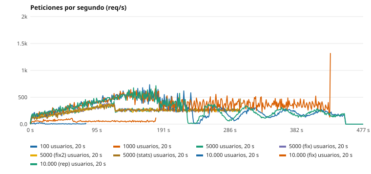

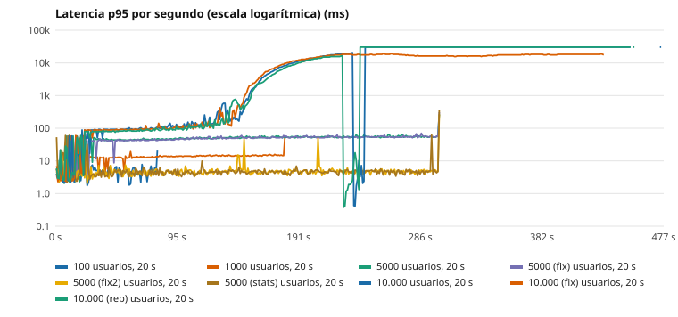

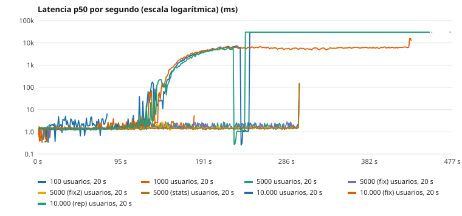

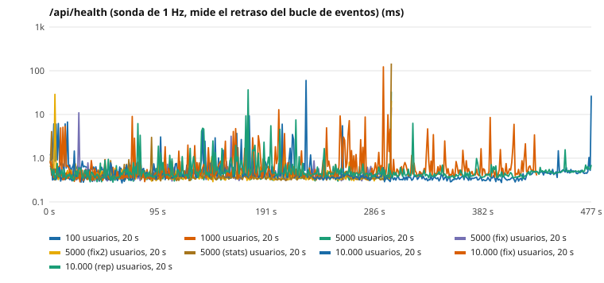

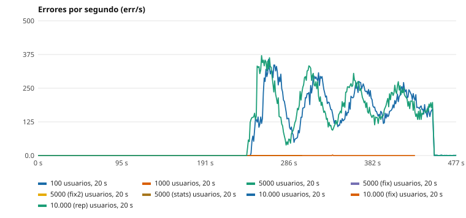

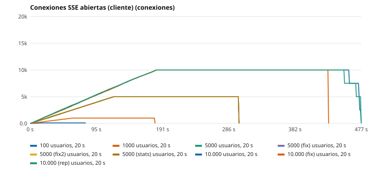

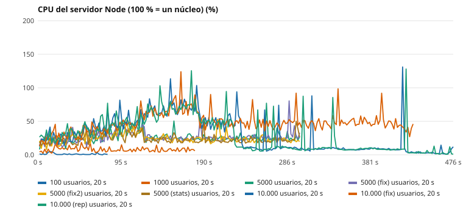

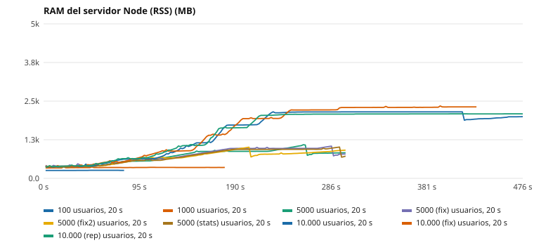

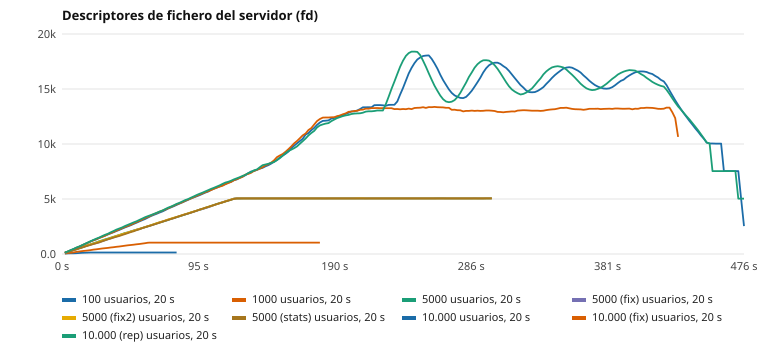

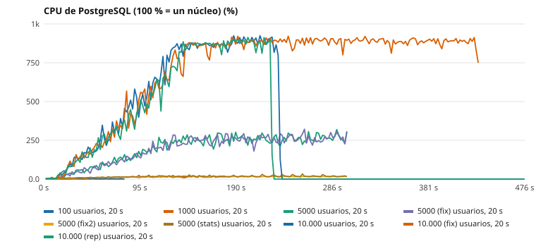

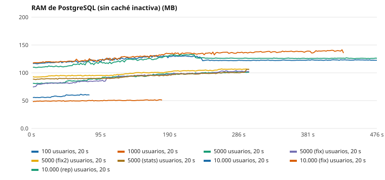

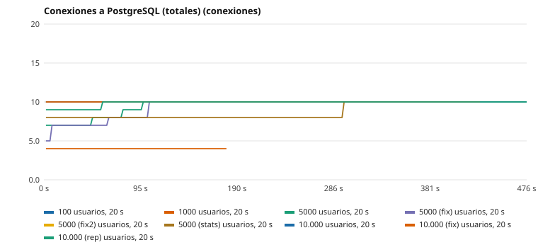

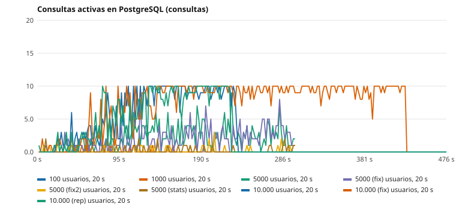

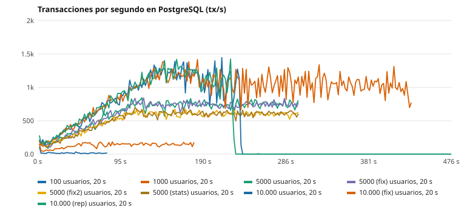

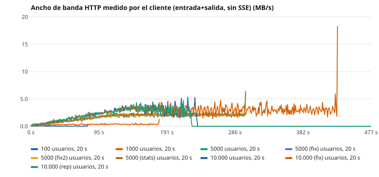

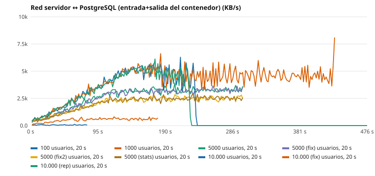

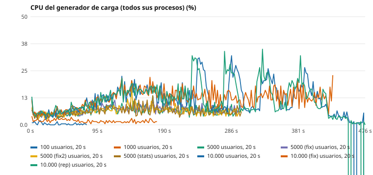

## Conclusiones

Escritas a mano a partir de las mediciones de arriba (`scripts/load/conclusions.md`; el informe las incluye al regenerarse). Todo lo medido es **en esta máquina, con el generador de carga y PostgreSQL en el mismo equipo** y con la mezcla de uso descrita arriba.

### Qué aguanta esta máquina

- **Hasta ~5.000 usuarios conectados a la vez, sin problemas**: 0 errores, p50 1,5 ms, p95 53 ms, p99 62 ms con ~260 peticiones/s; el servidor Node usó ~0,3 núcleos y ~1,1 GB de RAM (casi todo son las 5.000 conexiones SSE y la cola de peticiones), PostgreSQL ~2,6 núcleos y ~100 MB. Hay margen en Node; el recurso que se gasta es la **CPU de PostgreSQL**.
- **Entre ~6.000 y ~7.500 usuarios empieza la saturación** (la latencia p95 pasa de 0,5 s con 7.300-7.800 usuarios activos en las dos pruebas de 10.000). PostgreSQL llega a ~9 núcleos de CPU y el pool de 10 conexiones del servidor se llena; las peticiones se encolan, la latencia crece hasta ~20 s y el RAM de Node sube hasta ~2 GB (peticiones en cola).
- **Con 10.000 usuarios el servidor se cuelga y no se recupera solo.** Pasó en las dos pruebas: tras ~4 minutos de saturación, PostgreSQL pasa a 0 % de CPU, las 10 conexiones del pool quedan «idle in transaction» y todas las rutas que tocan la base agotan el tiempo (`/api/config`, que no usa la base, sigue respondiendo en <2 ms: el proceso no está caído, está bloqueado en sus accesos a la base). Hay que reiniciar el servidor. **Es un hallazgo importante por sí mismo**, más que el techo de usuarios (ver abajo).
- Con 100 y 1.000 usuarios todo es trivial (p95 6 y 14 ms, CPU <20 %).

«Usuario simultáneo» aquí = app abierta con su conexión SSE y una acción cada ~20 s (±50 %, es decir ~0,05 peticiones/s por usuario; el 10 % estudia en bucle). Una app de estudio por pomodoros pasa la mayor parte del tiempo parada (25-50 min por sesión), así que el uso real podría ser **más ligero** que este modelo, pero no hay datos de uso real para afirmarlo: si los jugadores consultan rankings más a menudo, el techo baja proporcionalmente.

### Cuello de botella y hallazgos

1. **Ranking global (`GET /api/leaderboard?scope=global`)**: p50 ~51 ms con 5.000 jugadores (los demás endpoints están en 0,2-12 ms) y es la mayor parte de la CPU de PostgreSQL (~2,6 núcleos con solo ~260 peticiones/s). Hace un `count(*)` con join sobre toda la tabla y otro conteo para «mi posición» en cada petición, así que su coste **crece con el número de jugadores**. Candidato claro de mejora: cachear la respuesta global/por país unos segundos en memoria (todos los jugadores ven lo mismo salvo `mine`) o mantener el total aparte. No se ha modificado nada del servidor en esta tarea.
2. **Bloqueo del pool bajo saturación (hipótesis, no demostrada con un cambio de código)**: en el momento del cuelgue las 10 conexiones están «idle in transaction» y la última consulta de todas es `select … from player_docs … for update` (el inicio de `runGameAction`), es decir, cada transacción espera algo que **no es la base**. Lo único compartido que se espera ahí es la recarga del contenido vivo (`ensureLoaded` en `server/content/service.ts`: una promesa `loading` compartida, cada 60 s): si la dispara alguien que usa el pool normal (`GET /api/content`, el tick de 30 s) mientras las 10 conexiones están ocupadas por transacciones que esperan esa misma promesa, nadie avanza. Encaja con que también `content.get` falle. Para confirmarlo y arreglarlo: recargar el contenido fuera de las transacciones (o con una conexión reservada) y poner tiempos máximos (`statement_timeout`, `idle_in_transaction_session_timeout`) para que un bloqueo se cure solo.
3. **Registro e inicio de sesión (scrypt)**: ~60 ms de CPU cada uno en el pool de 4 hilos de libuv; el máximo medido fue ~75 altas/s con 4 hilos (a costa de ~440 % de CPU del proceso y latencias de ~1,3 s por la cola). Un pico de registros (p. ej. un lanzamiento) se atiende a ese ritmo; no hay límite global, solo por IP (5 altas/hora/IP).
4. **RAM**: base ~260 MB; con 5.000 SSE ~0,9-1,1 GB; con 10.000 y cola ~2,1 GB. Estimación: ~0,1-0,17 MB por usuario conectado, más lo que ocupen las peticiones encoladas. PostgreSQL solo 50-130 MB de RAM (la base de 10.000 jugadores pesa ~70 MB).
5. **Red**: ~2 MB/s de HTTP con 5.000 usuarios (~0,4 KB/s por usuario) y ~0,6 KB/s de PostgreSQL↔servidor por usuario; las SSE solo mandan un `: ping` cada 25 s. No es un límite en ningún nivel (todo fue por loopback: **no se ha medido** la red real, TLS ni la latencia de los clientes).
6. **Descriptores de fichero**: ~1 por usuario conectado (+ conexiones de peticiones); el límite del sistema aquí es 524.288, pero en un contenedor/servidor con `ulimit -n 1024` el servidor se quedaría sin descriptores a unos 1.000 usuarios SSE. Comprobarlo en producción.
7. Un solo proceso: bus de eventos, límites de uso y recarga de contenido viven en memoria (ya documentado en `docs/server.md`); no se puede escalar a varias instancias sin cambiarlo.

### Qué esperar en producción

**No lo sé.** No conozco la máquina real de producción (CPU, RAM, disco, si PostgreSQL comparte núcleos con la app, ni su proxy/TLS): `docker-compose.yml` no fija límites y no he tocado ni consultado el servidor real. Lo que sí se puede decir con lo medido, para dimensionarlo tú:

- Para ~5.000 usuarios conectados con este patrón hacen falta, como orden de magnitud, **~1 núcleo para Node, ~3 núcleos para PostgreSQL (mientras el ranking global siga sin caché), ~1,5 GB de RAM para la app y ~0,2 GB para PostgreSQL**. Con 1-2 vCPU compartidas el techo estará mucho más abajo que aquí (esta CPU es un Ryzen 5 7500F, rápido), probablemente en el orden de cientos o pocos miles de usuarios con este patrón; es una extrapolación, no una medida.
- El inicio de sesión cuesta ~60 ms de CPU: con 2 hilos efectivos, una oleada de 1.000 inicios de sesión simultáneos tardaría del orden de 30 s en atenderse.
- Antes de cualquier lanzamiento a miles de jugadores: arreglar/confirmar el bloqueo del punto 2, cachear el ranking global y volver a ejecutar estas pruebas (`npm run load:run -- --levels 5000,10000`). Para saber el techo real en producción, ejecutar el mismo script **contra una réplica local con los mismos recursos** (el script no admite apuntar a producción a propósito).

### Limitaciones de estas pruebas

- Mismo equipo para generador, servidor y PostgreSQL (el generador gastó solo ~5-20 % de CPU, no es el límite, pero compite por la memoria y el planificador); en el equipo había ~8 GB ya ocupados por otros procesos (RAM libre mínima medida: ~4 GB).
- Una sola ejecución por nivel (más una repetición de 10.000 que dio el mismo resultado): sin intervalos de confianza.
- Modelo de uso inventado (cada ~20 s, 10 % estudia); el ritmo real puede ser distinto. No cubierto: grupos de estudio, intercambios, amigos escribiendo, push, clima, panel de admin, subida de imágenes, difusión masiva de eventos SSE (`content`/`event_announce` a todos), acciones de oleadas (`throwBall`…), cierres de sesión reales a los 25 min.
- Las sesiones de estudio adelantan el reloj con `x-dev-now` (`DEV_TOOLS=1`); el coste del servidor es el mismo, pero `DEV_TOOLS` también desactiva los bloqueos de cambio de nombre/país (irrelevante aquí).
- PostgreSQL 16 sin ajustar (valores por defecto) en docker, con disco real; producción usa PostgreSQL 17. Una configuración afinada (p. ej. `shared_buffers`) o un pool mayor cambiaría los números.
